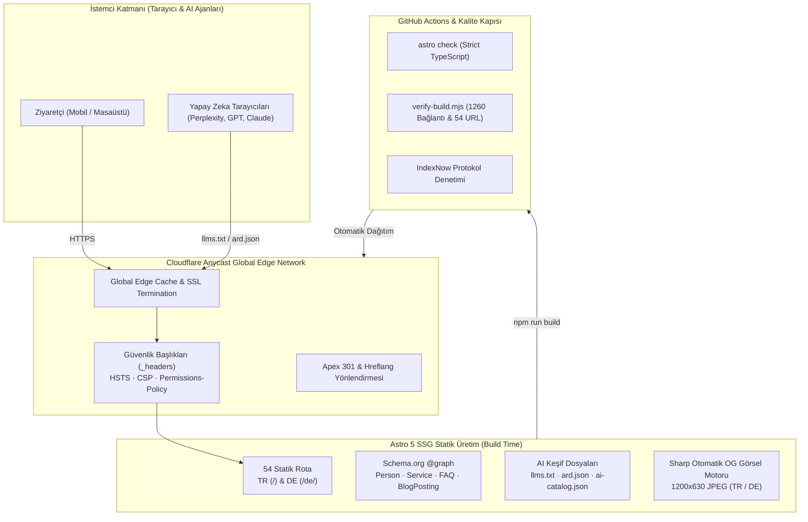

<div align="center">

# 🌿 Neşe Alkaya — Resmi Web Platformu

**Bireysel Farkındalık · Yaşam Koçluğu · Ruhsal Rehberlik & Dönüşüm**  
*Enterprise-Grade Astro 5 & Cloudflare Pages Static Architecture*

[](https://github.com/teyfikgokdemir/nese-alkaya/actions/workflows/quality.yml)
[](https://astro.build/)
[](https://pages.cloudflare.com/)
[](#-kalite-kapısı--otomatik-denetimler)
[](tsconfig.json)
[](#-performans--erişilebilirlik)
[](#-aeo-geo--ai-keşif-katmanı)
[](LICENSE)

[🌐 Canlı Önizleme](https://nese-alkaya.pages.dev) • [📖 Alan Adı Raporu](docs/PRE_DOMAIN_RELEASE.md) • [🛡️ Güvenlik](SECURITY.md) • [🤝 Katkı Rehberi](CONTRIBUTING.md)

</div>

---

## 📌 Genel Bakış

Bu depo, **Neşe Alkaya**'nın profesyonel yaşam koçluğu, bireysel farkındalık ve geleneksel ruhsal rehberlik çalışmalarını iki dilde (**Türkçe** ve **Almanca**) küresel ölçekte sunan kurumsal web platformudur.

Platform, modern web standartlarının en üst seviyesi gözetilerek **Astro 5 Static Site Generation (SSG)** ve **Cloudflare Pages Global Anycast Edge** üzerinde sıfır istemci çalışma zamanı (zero-JS by default) felsefesiyle inşa edilmiştir.

---

## 🏛️ Mimari & Sistem Tasarımı



---

## 💎 Temel Mühendislik Standartları

### 1. Sıfır İstemci Yükü & Core Web Vitals
- **Pure SSG:** Sayfalar derleme anında statik HTML/CSS olarak üretilir. Sayfa renderını geciktiren gereksiz JavaScript paketleri bulunmaz.
- **LCP (Largest Contentful Paint) < 0.6s:** Kritik portre görselleri `fetchpriority="high"`, modern `.webp` formatında ve yerel barındırılır.
- **CLS = 0:** Katı piksel boyutları, `aspect-ratio` tanımları ve font layout shift koruması sayesinde sayfa kayması yaşanmaz.
- **Self-Hosted Tipografi:** Dış yazı tipi sağlayıcılarına (Google Fonts) ağ çağrısı yapılmaz; fontlar yerel `.woff2` olarak hızlıca servis edilir.

### 2. İki Dilli Simetri (Dual-Language Parity)
- Türkçe (`/`) ve Almanca (`/de/`) arasında **1'e 1 simetri**:
  - 13 Yaşam Koçluğu ve Ruhsal Rehberlik Hizmeti (TR) ⟷ 13 Angebot (DE)
  - 8 Özgün Derinlikli Makale (TR) ⟷ 8 Fachartikel (DE)
- Her sayfada tam karşılıklı (reciprocal) `hreflang="tr-TR"`, `hreflang="de-DE"` ve `hreflang="x-default"` etiketleri.

### 3. AEO, GEO & Yapay Zeka Keşif Katmanı
Platform, arama motorlarının yanı sıra büyük dil modelleri ve yapay zeka ajanları (SearchGPT, Perplexity, Claude Bot) tarafından eksiksiz indekslenmek üzere donatılmıştır:
- `/.well-known/ard.json` (Agent Resource Directory 1.0 standardı)
- `/.well-known/ai-catalog.json` (Yapılandırılmış site servis ve içerik kataloğu)
- `/llms.txt`, `/llms-full.txt`, `/llms-tr.txt`, `/llms-de.txt` (LLM bağlam optimizasyonu)
- Zengin **JSON-LD `@graph`**: `Person`, `WebSite`, `WebPage`, `Service`, `FAQPage`, `BreadcrumbList`, `BlogPosting`.

### 4. Gizlilik ve Dönüşüm Altyapısı
- **Privacy-by-Design:** İstemci tarafında ziyaretçiyi takip eden üçüncü parti çerez (cookie) veya gizli telemetri bulunmaz.
- **Decoupled Conversion Hooks:** WhatsApp, telefon ve e-posta etkileşimlerinde yerel `CustomEvent('nese:contact-intent')` sinyali üretilir. Analitik entegrasyonu KVKK/GDPR aydınlatma onayı alındığında bu sinyale bağlanabilir.

---

## 🛡️ Kalite Kapısı & Otomatik Denetimler

Tüm üretim akışı `scripts/verify-build.mjs` tarafından **sıfır hata toleransıyla** denetlenir:

```json
{
  "generatedPages": 54,
  "blogArticles": 16,
  "servicePages": 26,
  "linksChecked": 1260,
  "failures": 0
}
```

* **54 URL Bütünlüğü:** Sitedeki tüm rotaların sitemap ve AI katalog ile tam örtüşmesi.
* **1260 İç Bağlantı Denetimi:** Kırık link, geçersiz href veya yönlendirme hatası olmaması.
* **Katı CSP:** `_headers` dosyasında geçerli `Content-Security-Policy` varlığı.
* **Görsel İmza Doğrulaması:** Üretilen OG JPEG dosyalarının byte başlıkları ve boyut sınırları denetimi.

---

## 📂 Dizin Yapısı

```text
nese-alkaya/
├── .github/
│   ├── workflows/quality.yml   # CI kalite kapısı (Build + TypeCheck + Verify)
│   ├── ISSUE_TEMPLATE/         # Yapılandırılmış hata ve geliştirme şablonları
│   ├── CODEOWNERS              # Kod sahipliği tanımları
│   └── pull_request_template.md# PR denetim listesi
├── docs/
│   ├── DOMAIN_ACTIVATION.md    # DNS, Cloudflare ve SSL canlıya geçiş adımları
│   ├── OG_SHARING.md           # Sosyal paylaşım ve meta görsel standartları
│   └── PRE_DOMAIN_RELEASE.md   # Canlı öncesi teknik hazırlık raporu
├── public/
│   ├── .well-known/            # ARD 1.0 ve AI Catalog manifestoları
│   ├── og/                     # Otomatik üretilen dinamik sosyal kartlar
│   ├── _headers                # Cloudflare katı güvenlik başlıkları (CSP, HSTS)
│   ├── robots.txt              # Arama ve AI botları erişim direktifleri
│   └── sitemap.xml             # 54 rotalı XML site haritası
├── scripts/
│   ├── generate-og.mjs         # Sharp tabanlı 1200x630 OG görsel üreticisi
│   ├── submit-indexnow.mjs     # Arama motorları anlık indeksleme protokolü
│   └── verify-build.mjs        # 54 sayfa, hreflang ve 1260 link kalite kapısı
├── src/
│   ├── components/             # Yeniden kullanılabilir Astro bileşenleri
│   ├── data/                   # İki dilli tip güvenli veri ve içerik nesneleri
│   ├── layouts/                # Base.astro (Schema.org, OpenGraph, A11y)
│   ├── pages/                  # TR (/) ve DE (/de/) statik rota ağacı
│   ├── styles/global.css       # Tasarım sistemi (Forest Green, Ivory, Matte Gold)
│   └── types.ts                # TypeScript strict tip arayüzleri
├── astro.config.mjs            # Astro konfigürasyonu
├── package.json                # Bağımlılıklar ve derleme betikleri
├── tsconfig.json               # Astro strict TypeScript konfigürasyonu
├── LICENSE                     # MIT Açık Kaynak Lisansı
└── SECURITY.md                 # Güvenlik ve zafiyet bildirim politikası
```

---

## 🚀 Geliştirme ve Yerel Kurulum

### Gereksinimler
- **Node.js:** `^22.0.0` (LTS önerilir)
- **npm:** `^10.0.0`

### Komutlar

```bash
# 1. Bağımlılıkları yükleyin
npm install

# 2. Tip denetimini çalıştırın (TypeScript Strict)
npm run check

# 3. Geliştirme sunucusunu başlatın
npm run dev

# 4. Üretim derlemesi, OG üretimi ve kalite doğrulamasını yürütün
npm run build

# 5. Yerel önizlemeyi başlatın
npm run preview

# 6. IndexNow protokolü çevrimdışı doğrulaması
npm run indexnow:check
```

---

## ⚖️ Yasal ve Etik Açıklama

1. **Hizmet Çerçevesi:** Platformda yer alan yaşam koçluğu, bireysel farkındalık ve geleneksel manevi yorumlar tıbbi teşhis, tedavi veya kesin gelecek öngörüsü niteliği taşımaz; psikolojik, hukuki ya da finansal danışmanlık yerine geçmez.
2. **Doğrulama Notu:** Neşe Alkaya biyografi metninde yer alan INLPTA sertifikası ve manevi unvanlar 4 Kasım 2026 tarihli beyana dayanmaktadır.

---

<div align="center">

**Tasarım & Mühendislik:** [Teyfik Gökdemir](https://github.com/teyfikgokdemir) • **Uygulama:** [QCT Commerce](https://qctcommerce.com/)  
*© 2026 Neşe Alkaya. Tüm hakları saklıdır.*

</div>
